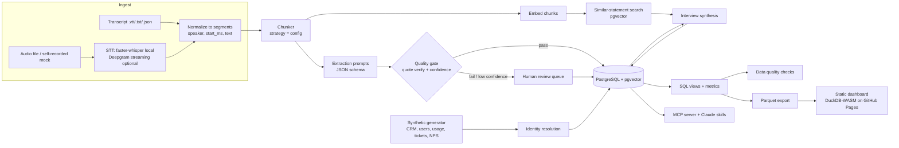
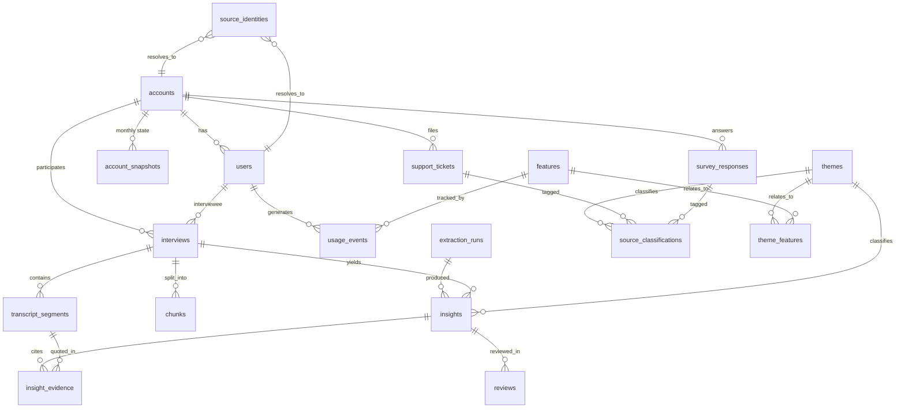

# Project Charter: Verbatim

*Working name was "Interview Insight Engine." Owner: Jared Brodd. Status: plan, not yet built. Public, open source (MIT).*

**Name options**
1. **Verbatim** (recommended). The promise in one word: every quote is real.
2. **Evidence Ledger**. Auditable trail from quote to roadmap; sounds a bit fintech.
3. **Quotebound**. Specific, but undersells the analytics half.

Check GitHub/PyPI availability; fall back to `verbatim-insights`.

---

## 1. Pitch

PMs run lots of customer interviews, then lose most of what was said. Notes are uneven, the insights deck cites quotes nobody can find, and interview evidence never meets the data that would make it believable: what the customer pays, how they use the product, what they file in support. **Verbatim turns interviews into evidence you can trust and query.** It extracts pain points, requests, jobs-to-be-done, and quotes as structured data, proves every quote exists word-for-word in the transcript, finds similar statements from past interviews, and joins it all to tickets, usage, NPS, and CRM data in one model. The result is a PM who can say "11 accounts worth $48K MRR raised this, here are the verified quotes, and their usage of the feature dropped 30%," and back up every word.

## 2. Goals, non-goals, success criteria

**Goals**
- A working, documented pipeline from audio or transcript to verified, structured insights.
- A unified data model that links interview evidence to tickets, usage, NPS, and CRM data, with identity resolution done properly.
- A public model bake-off with real numbers on quality, latency, and cost.
- A static dashboard anyone can explore without signing in or running a backend.
- Packaging (MCP server plus Claude skills) so another PM can run it on their own transcripts.

**Non-goals**
- Not a SaaS product: no auth, no multi-tenant hosting, no billing.
- No real customer data, ever (see section 12).
- No fine-tuning. Prompting, retrieval, and evaluation only.
- No polished live-call UI. Streaming STT is an optional demo path, not the core.

**Success criteria (measurable)**

| Criterion | Target |
|---|---|
| Displayed quotes verified verbatim | 100%, enforced by the gate |
| Planted-pain-point recall, held-out set | ≥ 85% |
| Identity resolution accuracy vs. ground truth | ≥ 97% |
| Bake-off | ≥ 4 models × 3 runs, cost per 1,000 calls |
| Dashboard | < 3 s load on GitHub Pages, no backend |
| Reuse | Quickstart < 10 min; one-command MCP install |
| Shipping | 4 tagged releases, one per week |

**What a hiring manager should conclude:** "This PM can take an AI feature from data model to eval to shipped artifact. He sets a measurable quality bar and enforces it in code, picks models on evidence instead of hype, and can write the SQL that answers the roadmap question himself."

## 3. Users and jobs-to-be-done

| User | Job-to-be-done |
|---|---|
| PM running discovery | "Give me a quote-backed summary minutes after the call." |
| PM prioritizing | "Show how often a problem comes up, in which segments, for how much revenue, with evidence I can defend." |
| Second PM / research ops | "Let me run the same process at the same quality." |
| Skeptical stakeholder | "Let me click from a claim to the moment a customer said it." |

## 4. Architecture



Extraction and embedding run in parallel per chunk, so a slow model never blocks retrieval. Synthesis reads only gated insights, so a fake quote can't reach the summary.

## 5. Data model (centerpiece)

### 5.1 Database decision

**PostgreSQL 16 + pgvector as the system of record; DuckDB-WASM over Parquet exports for the public dashboard.**
- Postgres is what Jared uses daily and what most teams run. pgvector keeps embeddings beside business data, so "similar quotes from high-MRR churned accounts" is one SQL join.
- **Why not Pinecone:** a second store to keep in sync, no joins to accounts or usage, and an extra signup in the quickstart. Under 100K vectors, pgvector with HNSW is plenty fast.
- DuckDB reads the same Parquet in the browser, so the dashboard needs no server. Views use portable SQL; dialect differences live in one macro file.
- Local: Docker Compose. Optional hosted: Neon or Supabase free tier.

### 5.2 ERD



### 5.3 Identity resolution

Each source arrives with its own keys, just like in real life:

| Source | Native keys |
|---|---|
| CRM | `crm_account_id`, contact emails, company domain |
| Product usage | `workspace_id`, `product_user_id` |
| Support | requester email (sometimes personal), free-text company |
| NPS survey | respondent email |
| Interviews | calendar invite email, interviewee name |

The resolver writes one `source_identities` row per source record, using the first rule that matches:
1. **Exact key**: `workspace_id` → account via the CRM's workspace mapping.
2. **Normalized email**: lowercase, trim, remove `+tags` and Gmail dots → `users.email_norm`.
3. **Company domain**: email domain → `accounts.domain`, skipping free-mail domains. Matches to the account only, not a user.
4. **Unresolved**: kept with `match_method = 'none'` and counted, never dropped.

Each row stores `match_method` and `match_confidence`. The generator adds deliberate mess and records the true IDs separately, so resolver accuracy is a measured number, not a claim.

### 5.4 How insights trace back to evidence

`insight` → `insight_evidence` (one or more quotes) → `transcript_segments` (speaker, timestamps) → `interviews` → `accounts`. Each evidence row stores the quote, character offsets within the segment, `verified`, and `match_score`. Every insight also records the `extraction_run` (model, prompt version hash, chunk strategy), so any number on the dashboard can be traced to an exact quote, timestamp, model, and prompt.

### 5.5 Core DDL (PostgreSQL)

```sql
CREATE EXTENSION IF NOT EXISTS vector;

-- ---------- CRM / accounts ----------
CREATE TABLE accounts (
  account_id     TEXT PRIMARY KEY,               -- 'acc_000123'
  crm_account_id TEXT UNIQUE NOT NULL,
  name           TEXT NOT NULL,
  domain         TEXT UNIQUE,
  segment        TEXT NOT NULL CHECK (segment IN ('smb','mid_market','enterprise')),
  industry       TEXT,
  region         TEXT,
  created_at     DATE NOT NULL,
  churned_at     DATE
);

CREATE TABLE account_snapshots (               -- monthly plan/MRR history
  account_id  TEXT REFERENCES accounts,
  month       DATE NOT NULL,                     -- first of month
  plan        TEXT NOT NULL CHECK (plan IN ('starter','growth','scale')),
  mrr_usd     NUMERIC(10,2) NOT NULL CHECK (mrr_usd >= 0),
  status      TEXT NOT NULL CHECK (status IN ('active','churned','trial')),
  PRIMARY KEY (account_id, month)
);

CREATE TABLE users (
  user_id          TEXT PRIMARY KEY,
  account_id       TEXT NOT NULL REFERENCES accounts,
  product_user_id  TEXT UNIQUE,
  email_norm       TEXT UNIQUE NOT NULL,
  role             TEXT,                          -- admin, manager, end_user
  created_at       DATE NOT NULL
);

CREATE TABLE source_identities (
  source_system    TEXT NOT NULL CHECK (source_system IN ('crm','product','support','survey','interview')),
  source_key       TEXT NOT NULL,                 -- raw key/email as received
  account_id       TEXT REFERENCES accounts,
  user_id          TEXT REFERENCES users,
  match_method     TEXT NOT NULL CHECK (match_method IN ('exact_key','email','domain','none')),
  match_confidence REAL NOT NULL CHECK (match_confidence BETWEEN 0 AND 1),
  PRIMARY KEY (source_system, source_key)
);

-- ---------- Product usage ----------
CREATE TABLE features (
  feature_key  TEXT PRIMARY KEY,                  -- 'reports', 'bulk_import'
  name         TEXT NOT NULL,
  launched_at  DATE
);

CREATE TABLE usage_events (
  event_id     BIGINT PRIMARY KEY,
  user_id      TEXT NOT NULL REFERENCES users,
  account_id   TEXT NOT NULL REFERENCES accounts,  -- denormalized for speed
  feature_key  TEXT NOT NULL REFERENCES features,
  event_name   TEXT NOT NULL,
  occurred_at  TIMESTAMPTZ NOT NULL
);
CREATE INDEX ON usage_events (account_id, feature_key, occurred_at);

-- ---------- Support + survey ----------
CREATE TABLE support_tickets (
  ticket_id        TEXT PRIMARY KEY,
  requester_email  TEXT NOT NULL,                 -- raw; resolved via source_identities
  account_id       TEXT REFERENCES accounts,      -- filled by resolver, nullable
  user_id          TEXT REFERENCES users,
  created_at       TIMESTAMPTZ NOT NULL,
  category         TEXT,
  priority         TEXT CHECK (priority IN ('low','normal','high','urgent')),
  status           TEXT,
  subject          TEXT NOT NULL,
  body             TEXT NOT NULL,
  body_hash        TEXT NOT NULL                  -- dedupe check
);

CREATE TABLE survey_responses (
  response_id      TEXT PRIMARY KEY,
  survey_wave      TEXT NOT NULL,                 -- '2026-Q1'
  respondent_email TEXT NOT NULL,
  account_id       TEXT REFERENCES accounts,
  user_id          TEXT REFERENCES users,
  submitted_at     TIMESTAMPTZ NOT NULL,
  nps_score        SMALLINT NOT NULL CHECK (nps_score BETWEEN 0 AND 10),
  comment          TEXT
);

-- ---------- Interviews ----------
CREATE TABLE interviews (
  interview_id   TEXT PRIMARY KEY,
  account_id     TEXT REFERENCES accounts,
  user_id        TEXT REFERENCES users,
  conducted_at   TIMESTAMPTZ NOT NULL,
  source_type    TEXT NOT NULL CHECK (source_type IN ('audio','transcript')),
  data_origin    TEXT NOT NULL CHECK (data_origin IN ('synthetic','self_recorded')),
  duration_sec   INT,
  stt_engine     TEXT                              -- null for text-only
);

CREATE TABLE transcript_segments (
  segment_id    BIGSERIAL PRIMARY KEY,
  interview_id  TEXT NOT NULL REFERENCES interviews ON DELETE CASCADE,
  seq           INT NOT NULL,
  speaker       TEXT NOT NULL CHECK (speaker IN ('interviewer','customer','other')),
  start_ms      INT NOT NULL,
  end_ms        INT NOT NULL,
  text          TEXT NOT NULL,
  UNIQUE (interview_id, seq)
);

CREATE TABLE chunks (
  chunk_id        BIGSERIAL PRIMARY KEY,
  interview_id    TEXT NOT NULL REFERENCES interviews ON DELETE CASCADE,
  strategy        TEXT NOT NULL,                  -- 'fixed_800_100','turn_pair','topic'
  first_seq       INT NOT NULL,
  last_seq        INT NOT NULL,
  text            TEXT NOT NULL,
  embedding       vector(384)
);
CREATE INDEX ON chunks USING hnsw (embedding vector_cosine_ops);

-- ---------- Extraction + gate ----------
CREATE TABLE extraction_runs (
  run_id          TEXT PRIMARY KEY,
  provider        TEXT NOT NULL,                  -- groq, deepinfra, anthropic
  model           TEXT NOT NULL,
  prompt_version  TEXT NOT NULL,                  -- content hash of prompt files
  chunk_strategy  TEXT NOT NULL,
  started_at      TIMESTAMPTZ NOT NULL,
  input_tokens    BIGINT,
  output_tokens   BIGINT,
  cost_usd        NUMERIC(10,4),
  p50_latency_ms  INT,
  p95_latency_ms  INT
);

CREATE TABLE themes (
  theme_id     TEXT PRIMARY KEY,                  -- 'th_reporting_speed'
  label        TEXT NOT NULL,
  description  TEXT NOT NULL,
  parent_id    TEXT REFERENCES themes
);

CREATE TABLE theme_features (                     -- which feature a theme is "about"
  theme_id     TEXT REFERENCES themes,
  feature_key  TEXT REFERENCES features,
  PRIMARY KEY (theme_id, feature_key)
);

CREATE TABLE insights (
  insight_id     TEXT PRIMARY KEY,
  interview_id   TEXT NOT NULL REFERENCES interviews,
  run_id         TEXT NOT NULL REFERENCES extraction_runs,
  insight_type   TEXT NOT NULL CHECK (insight_type IN ('pain_point','feature_request','jtbd','praise','objection')),
  summary        TEXT NOT NULL,
  theme_id       TEXT REFERENCES themes,
  sentiment      REAL CHECK (sentiment BETWEEN -1 AND 1),
  severity       SMALLINT CHECK (severity BETWEEN 1 AND 5),
  confidence     REAL NOT NULL CHECK (confidence BETWEEN 0 AND 1),
  gate_status    TEXT NOT NULL CHECK (gate_status IN ('passed','needs_review','rejected','approved','edited')),
  embedding      vector(384),
  created_at     TIMESTAMPTZ NOT NULL DEFAULT now()
);

CREATE TABLE insight_evidence (
  evidence_id    BIGSERIAL PRIMARY KEY,
  insight_id     TEXT NOT NULL REFERENCES insights ON DELETE CASCADE,
  segment_id     BIGINT NOT NULL REFERENCES transcript_segments,
  quote          TEXT NOT NULL,
  char_start     INT,
  char_end       INT,
  verified       BOOLEAN NOT NULL,
  match_type     TEXT NOT NULL CHECK (match_type IN ('exact','normalized','fuzzy','none')),
  match_score    REAL NOT NULL
);

CREATE TABLE source_classifications (            -- tickets + NPS comments mapped to the same themes
  source_type    TEXT NOT NULL CHECK (source_type IN ('ticket','survey')),
  source_id      TEXT NOT NULL,
  theme_id       TEXT NOT NULL REFERENCES themes,
  confidence     REAL NOT NULL,
  run_id         TEXT REFERENCES extraction_runs,
  PRIMARY KEY (source_type, source_id, theme_id)
);

CREATE TABLE reviews (
  review_id      BIGSERIAL PRIMARY KEY,
  insight_id     TEXT NOT NULL REFERENCES insights,
  reviewer       TEXT NOT NULL,
  decision       TEXT NOT NULL CHECK (decision IN ('approve','edit','reject')),
  reason         TEXT,
  reviewed_at    TIMESTAMPTZ NOT NULL DEFAULT now()
);

-- ---------- Unified fact: one row per "this account raised this theme" ----------
CREATE VIEW fct_theme_mentions AS
SELECT 'interview' AS source_type, i.insight_id AS source_id, iv.account_id,
       i.theme_id, iv.conducted_at AS occurred_at, i.sentiment, i.confidence
FROM insights i JOIN interviews iv USING (interview_id)
WHERE i.gate_status IN ('passed','approved','edited')
UNION ALL
SELECT 'ticket', t.ticket_id, t.account_id, c.theme_id, t.created_at, NULL, c.confidence
FROM source_classifications c JOIN support_tickets t ON c.source_type='ticket' AND c.source_id=t.ticket_id
UNION ALL
SELECT 'survey', s.response_id, s.account_id, c.theme_id, s.submitted_at,
       (s.nps_score - 5) / 5.0, c.confidence
FROM source_classifications c JOIN survey_responses s ON c.source_type='survey' AND c.source_id=s.response_id;
```

### 5.6 Synthetic data generator

There's no real data, so the generator *is* the dataset, and it gets the same care as production data.

- **Fictional company:** a mid-market B2B SaaS (say, field-service scheduling) with ~8 features. **Default scale:** 300 accounts, ~2,500 users, 12 months, ~400K events, ~3,000 tickets, ~1,200 NPS responses, 60 interviews.
- **Latent drivers:** each account gets a hidden `health` score and 0–3 planted pain points. Everything is generated from these, so the signals are real and recoverable:
  - Segments 60/30/10 (SMB/mid/enterprise); MRR lognormal by segment.
  - Usage: Poisson events per user-day scaled by health; a planted "reporting is slow" cuts `reports` usage 25–40%.
  - Churn hazard, ticket rate, and NPS all follow health; tickets and 40% of NPS comments come from templates tied to the planted pain points.
  - Interviews: an LLM writes each transcript from a persona brief, with filler, tangents, and a decoy topic. The planted points become eval labels.
- **Mess on purpose:** ~1% duplicate tickets, email aliases, personal emails, late events, ~2% orphans.
- **Reproducible:** one `--seed`, pinned generator version, `GENERATION.md` documenting every distribution. Ground truth sits in `truth/`, which the pipeline never reads.

### 5.7 Analytics layer

**Views and metric definitions** (in `sql/views/`):
- `dim_account_current`: latest snapshot per account, plus `user_count`, `mrr_quartile`, `is_churned`, and `tenure_months`.
- `usage_28d`: active users per account × feature over the trailing 28 days.
- `fct_theme_mentions`: unified mentions (shown above).
- `fct_feature_usage_weekly`: active users and events per account × feature × week.
- `mart_theme_scorecard`: per theme: distinct accounts, MRR represented, number of sources it appears in, top verified quote.
- `mart_pipeline_quality`: per run: quote pass rate, review rate, reviewer override rate, cost, latency.

**Definitions:** *Mentioning account* = at least one gated mention in the window. *Active feature user* = at least one event on the feature in the trailing 28 days. *High-MRR* = top quartile of current MRR. *Evidence strength* = distinct accounts × number of source types (1–3), with a minimum of 2 accounts.

**Questions the dashboard answers (query sketches):**

1. **Which pain points come up most among churned or high-MRR accounts?**
   ```sql
   SELECT m.theme_id, COUNT(DISTINCT m.account_id) accts, SUM(a.mrr_usd) mrr
   FROM fct_theme_mentions m JOIN dim_account_current a USING (account_id)
   WHERE a.is_churned OR a.mrr_quartile = 4
   GROUP BY 1 ORDER BY mrr DESC;
   ```
2. **Do accounts that mention theme X use feature Y less?** Mentioning vs. non-mentioning accounts, within segment.
   ```sql
   WITH m AS (SELECT DISTINCT account_id FROM fct_theme_mentions WHERE theme_id = :x)
   SELECT a.segment, (m.account_id IS NOT NULL) mentioned,
          AVG(u.active_users_28d::float / NULLIF(a.user_count,0)) adoption_y
   FROM dim_account_current a LEFT JOIN m USING (account_id)
   JOIN usage_28d u ON u.account_id = a.account_id AND u.feature_key = :y
   GROUP BY 1,2;
   ```
3. **Theme frequency by segment over time:** `fct_theme_mentions` by month × segment × theme, per 100 accounts.
4. **Which themes do all three sources agree on?** Distinct `source_type` = 3, ranked by evidence strength.
5. **NPS gap by theme:** average NPS of mentioning minus non-mentioning accounts, with n.
6. **Revenue at risk:** MRR of active accounts that mention a theme *and* whose weekly usage fell ≥ 20% over 8 weeks.
7. **Top feature requests:** by distinct accounts and MRR, each with its best verified quote linked to the timestamp.
8. **Do tickets lead interviews?** Weeks from first ticket mention to first interview mention, per theme.
9. **Pipeline health:** quote pass rate, review rate, and cost per interview by model and prompt version.

### 5.8 Dashboard (no backend)

- A build step exports views to Parquet (a few MB). A static page on GitHub Pages loads them with **DuckDB-WASM** and draws charts with **Observable Plot**.
- Pages: **Theme Explorer** (scorecard → click a theme → accounts, MRR, usage chart, verified quotes), **Interview Viewer** (transcript with insight highlights; hover a quote to see its gate result), **Bake-off** (quality vs. cost scatter, latency bars), **Data Health** (the checks below, with status pills).
- A read-only "Run SQL" box with the 9 questions preloaded as examples, so technical viewers can poke at the data themselves.

### 5.9 Data quality checks

Each check is a SQL file in `sql/checks/` that returns the failing rows (zero rows = pass). They run in CI on every push, and the results are published to the dashboard as `data_health.json`.

| Check | Rule |
|---|---|
| Freshness | Latest record per source within 2 days of generation date |
| Duplicates | No repeat `body_hash` per requester within 24 h; unique `event_id` |
| Orphaned insights | Every gated insight has ≥ 1 verified quote; every quote has a segment |
| Quote pass rate | ≥ 95% first pass (warn); 100% of displayed quotes (hard fail) |
| Identity match | ≥ 97% resolved; accuracy vs. `truth/` reported |
| Integrity | No null-account mentions reach marts |
| Drift | MRR, NPS, event volume within expected bands for the seed |

## 6. AI pipeline

### 6.1 Prompts to design (written from scratch, versioned by content hash)
1. **Chunk extractor**: speaker-labeled chunk in, schema-valid JSON out (type, summary, exact quotes with segment `seq`, sentiment, severity, confidence). Told to return nothing rather than guess.
2. **Cross-chunk merger**: collapses repeated points, keeps every quote.
3. **Theme assigner**: maps to the taxonomy or proposes a new theme (which goes to review).
4. **Ticket/NPS classifier**: same taxonomy, cheap model, batched.
5. **Synthesizer**: post-interview brief that may only cite gated insight IDs; quotes are filled in from the database, never written by the model.
6. **Faithfulness judge**: grades briefs; calibrated against 30 human-graded briefs first.

### 6.2 Quality gate
1. **Exact match** within the cited segments, then **normalized match** (case, whitespace, punctuation, "um").
2. **Fuzzy match** (rapidfuzz ≥ 92) never auto-passes; it goes to review with the closest real span shown.
3. No match: retry once on the cited segments only, then drop the quote; an insight with no verified quotes is rejected.
4. **Confidence routing:** below threshold, new theme, or severity 5 → `needs_review`. Threshold tuned on the labeled set to balance review load against errors.
5. Review CLI (later a demo page): approve, edit, reject, all logged to `reviews`.

The gate checks against the transcript, not the audio; STT error is measured separately as WER on self-recorded clips.

### 6.3 Chunking strategies, and how to pick one

| Strategy | Idea |
|---|---|
| Fixed window | ~800 tokens, 100 overlap |
| Turn pairs | Interviewer question + customer answer(s) as one unit |
| Topic segments | Split where adjacent-segment embedding similarity drops |
| Whole transcript | One long-context call (baseline) |

Scored on the labeled set: recall, precision, quote pass rate, duplicates, tokens, cost. **Hypothesis:** turn pairs win on quote accuracy; whole-transcript wins on cost but misses one-off mentions. Live mode uses a rolling 60-second window on a fast model (provisional), then a full pass after the call.

### 6.4 Model bake-off
- **Models:** small and large Llama on Groq, one or two open models on DeepInfra, one closed model (Claude Haiku-class). Exact IDs and prices pinned in a dated `pricing.yaml`.
- **Design:** same prompts and chunks, temperature 0, 3 runs each, cached by (model, prompt hash, chunk).
- **Metrics:** recall/precision vs. planted truth, JSON validity, first-pass quote verification, theme accuracy, p50/p95 latency, **cost per 1,000 calls** (measured tokens × list price).
- **Decision rule:** cheapest model clearing recall ≥ 85% and JSON validity ≥ 99% is the default; runner-up is the fallback. Published as a Pareto chart plus a one-page memo.

### 6.5 Labeled test set
- 50 synthetic transcripts with planted truth (40 dev, 10 held out and untouched until the final run).
- 6–8 **self-recorded** mock interviews (Jared plus friends acting from persona briefs), labeled by hand using a one-page labeling guide.
- Matching extracted insights to the gold labels uses an LLM judge plus a manual spot check of 20%. Disagreements are logged.

## 7. Tech stack

| Layer | Choice | Why |
|---|---|---|
| Language | Python 3.12, `uv`, Pydantic v2 | Schemas double as JSON validators |
| STT | faster-whisper local; Deepgram optional | Free by default |
| LLMs | Groq + DeepInfra (OpenAI-compatible), Anthropic SDK | One client shape; cheap open models + closed baseline |
| Embeddings | Small local open model (384-dim, e.g. bge-small) | Free, offline, reproducible |
| Store | PostgreSQL 16 + pgvector (Docker; Neon free optional) | Joins and vectors in one place |
| Checks | Plain SQL assertions + pytest | Readable to reviewers, no framework |
| Dashboard | Parquet + DuckDB-WASM + Observable Plot on GitHub Pages | Zero backend, free hosting |
| Packaging | MCP server (Python SDK) + Claude skills | Other PMs plug it in |
| CI | GitHub Actions | Tests, checks, Pages deploy |

**Budget target:** under $25 in API spend for the whole project. The demo path costs $0 to view.

## 8. Repo structure

```
verbatim/
├── README.md                 # pitch, 10-min quickstart, demo link, NDA note
├── docker-compose.yml        # postgres + pgvector
├── pyproject.toml
├── verbatim/
│   ├── ingest/               # stt.py, transcript parsers, normalize.py
│   ├── chunking/             # fixed.py, turns.py, topic.py
│   ├── extract/              # schemas.py, extractor.py, merge.py, themes.py
│   ├── gate/                 # verify_quotes.py, confidence.py, review_cli.py
│   ├── rag/                  # embed.py, search.py
│   ├── synth/                # brief.py
│   └── providers/            # groq.py, deepinfra.py, anthropic.py, pricing.yaml
├── prompts/                  # versioned prompt files (hash = prompt_version)
├── datagen/                  # generator, personas, GENERATION.md
├── identity/                 # resolver.py
├── sql/
│   ├── ddl/                  # 001_core.sql ...
│   ├── views/                # dim_, fct_, mart_
│   ├── questions/            # the 9 PM questions
│   └── checks/               # data quality assertions
├── evals/                    # labeling guide, gold/, bakeoff.py, reports/
├── mcp_server/               # tools: ingest, extract, verify_quotes, find_similar, query
├── skills/                   # Claude skills: interview-synthesis, evidence-lookup
├── dashboard/                # Vite + DuckDB-WASM + Plot
├── docs/                     # architecture, ERD, decisions log (ADRs)
└── .github/workflows/        # ci.yml, pages.yml
```

## 9. Four-week build plan (nights and weekends, ~10–12 h/week)

| Week | Ships to GitHub (tagged release) | Goes on the portfolio | Cut line if behind |
|---|---|---|---|
| **1. Data foundation** (`v0.1`) | DDL, ERD, synthetic generator (CRM, users, usage, tickets, NPS) with `GENERATION.md`, identity resolver with accuracy score, data checks in CI, 3 PM questions in SQL | Short post: "Designing the data model before the AI," with ERD and identity-resolution results | Drop drift checks; simpler mess rules |
| **2. Extraction + gate** (`v0.2`) | Transcript generator with planted truth, ingestion (text + faster-whisper on 2 self-recorded clips), turn-pair chunking, extractor, quote verifier, review CLI, labeled set v1 | Post: "Zero hallucinated quotes: building the gate," with pass-rate and review-rate numbers and a caught example | Self-recorded audio slips to week 3 |
| **3. RAG + bake-off** (`v0.3`) | Embeddings + pgvector similar-statement search, theme taxonomy + ticket/NPS classifier, all 4 chunking strategies, bake-off across ≥ 4 models with a memo | Post: "Llama vs. closed models for interview extraction: quality, latency, cost per 1,000 calls," with the Pareto chart | Drop topic chunking; 3 models minimum |
| **4. Analytics + packaging** (`v1.0`) | All views and 9 questions, DuckDB-WASM dashboard on Pages, MCP server + 2 Claude skills, synthesis brief, polished README | Full case study with embedded dashboard | Interview Viewer becomes static screenshots; one skill |

## 10. Portfolio case-study angle

**Frame:** "How do you make interview evidence something a roadmap review can trust?" Lead with the decision it supports, not the tech.

Structure: problem → the quality bar (the gate) → the data model linking quotes to revenue and usage → bake-off and model choice → what the dashboard shows → what I'd change.

**Embedded demo:** the Theme Explorer. Pick a theme; see accounts, MRR, usage vs. peers, and verified quotes that open the transcript at that line. A toggle, **"Show what the gate caught,"** puts rejected quotes beside the real transcript text. That one interaction explains the project in ten seconds. Second embed: the bake-off scatter.

## 11. Skills mapping

| # | Skill (SKILLS-MAP.md) | Where it shows up |
|---|---|---|
| 1 | Streaming speech-to-text | faster-whisper ingestion; optional Deepgram streaming live mode; WER on self-recorded clips |
| 2 | Chunking and windowing | Four chunking strategies compared; rolling window for live mode |
| 3 | Structured extraction | Pydantic-schema JSON extractor; JSON validity in bake-off |
| 4 | RAG | pgvector similar-statement search; "N other customers said this" |
| 5 | Parallel pipelines | Extraction and embedding run concurrently per chunk; async bake-off |
| 6 | Production prompt engineering | Versioned prompts, regression runs against the labeled set |
| 7 | Model evaluation and selection | Bake-off with decision rule and fallback |
| 8 | Cost and latency at scale | Cost per 1,000 calls, p50/p95 latency, `pricing.yaml` |
| 9 | Quality gates | Quote verification, confidence routing, review queue, pass-rate checks |
| 10 | Summarization | Post-interview synthesis brief with faithfulness judge |
| 11 | Data modeling and SQL | Unified model, identity resolution, views, 9 PM questions, data checks |
| 12 | Interface design and prototyping | Dashboard and Interview Viewer on realistic synthetic data |
| 13 | Shipping code | Public repo, PRs per feature, CI, 4 tagged releases |
| 14 | Agent and skill authoring | MCP server + Claude skills other PMs can install |
| 15 | Discovery and research | JTBD framing, labeling guide, self-recorded interviews, research-repository model |

## 12. NDA guardrails

Jared's employer runs a similar internal workflow. To keep this clean:
- **Built from scratch:** no prompts, schemas, code, vendor configs, intervals, taxonomies, or data from work, not even "inspired by" copies. Everything is written fresh in public commits.
- **Data:** synthetic (seeded) or self-recorded with consenting friends only.
- **Language:** an industry pattern ("a common approach is..."), never "how we do it at work." No employer volumes, vendors, or model choices.
- **Vendors** are justified from public docs and this project's own bake-off.
- **Separation:** personal laptop and accounts only; no work devices, repos, or keys.
- **Before each weekly post,** check it against this list; if in doubt, leave it out.

## 13. Risks and open questions

| Risk | Mitigation |
|---|---|
| Synthetic transcripts are too clean or share the extractor's biases | Filler and decoys; generate with one provider, extract with others; report self-recorded results separately |
| Scope creep (live mode, UI polish) | Live mode is optional; weekly cut lines are fixed in advance |
| Prices and model lineups change mid-project | Date-stamped `pricing.yaml`; note in the report that results reflect a single date |
| Looks too close to the employer's tool | Section 12; distinct naming, domain, and taxonomy; public commit history |
| DuckDB/Postgres SQL dialect drift | Portable SQL, a dialect macro file, CI runs questions on both |

**Open questions for Jared**
1. Which fictional product domain? (Field-service scheduling is suggested; it should be far from coaching.)
2. Is "Verbatim" free on GitHub, PyPI, and as a domain?
3. Who are 3–4 friends willing to record mock interviews?
4. Should the portfolio host the dashboard directly or link to GitHub Pages?
5. Which closed model to use as the baseline, and is a small Anthropic API spend OK?
